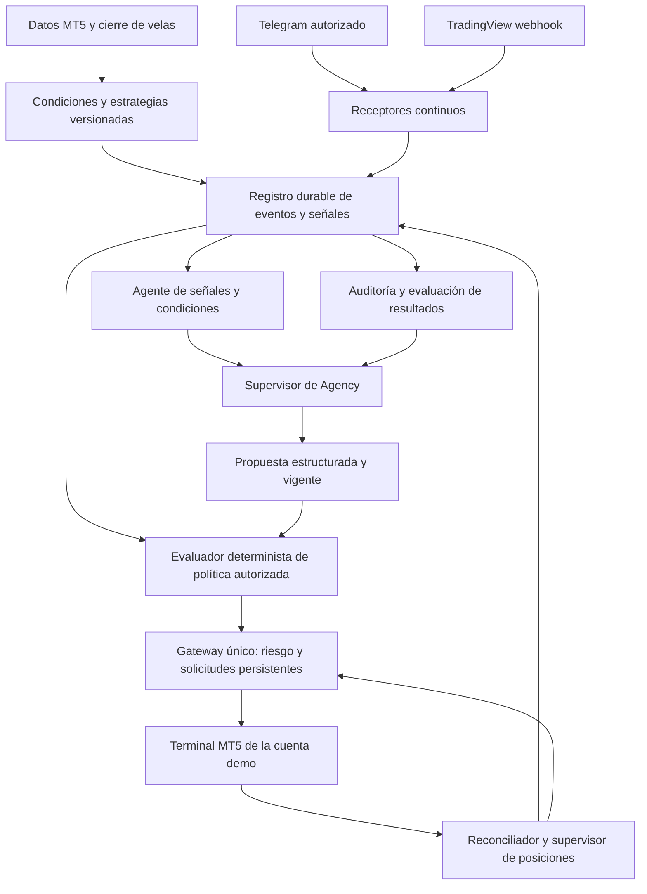

# Estudio de implementación: centro de operaciones MT5 + señales + Rinari Agency

Fecha: 21 de octubre de 2026. Estado: **diseño propuesto; no implementado ni activado**.

Este documento desarrolla las ocho mejoras de [IMPROVEMENT_PLAN.md](IMPROVEMENT_PLAN.md) y añade recepción de señales y coordinación de dos a ocho agentes. El objetivo inicial es una cuenta demo y el símbolo de bróker `XAUUSDm`. No establece una estrategia rentable ni autoriza operaciones por sí mismo.

## 1. Decisión de arquitectura

Usar Agency como centro de coordinación y decisión, un servicio continuo para recibir eventos y supervisar condiciones, y **un único gateway de ejecución por cuenta**. Telegram, TradingView, estrategias calculadas y agentes deben pasar por el mismo motor de políticas, riesgo, identidad de solicitudes y reconciliación.

Empezar con dos agentes: uno de señales y condiciones, otro supervisor que decide. Ampliar hasta ocho especialidades cuando se pueda medir su aportación. El número de agentes no multiplica el capital disponible ni los permisos de ejecución.

La automatización puede operar sin confirmación humana por operación dentro de una política previamente autorizada. Los agentes no pueden ampliar esa política, cambiar de cuenta, incorporar fuentes ni aumentar riesgo unilateralmente. Las verificaciones monetarias y del estado del bróker son código determinista.



El recorrido automático directo `señal → política → gateway` se habilitaría únicamente para fuentes y reglas expresamente autorizadas. El recorrido deliberativo `señal → agentes → propuesta → política → gateway` permite análisis adicional a costa de mayor latencia. Ambos usan las mismas restricciones. No se consulta a ocho modelos para cada tick.

## 2. Base revisada y límites de la evidencia

| Componente | Base examinada | Resultado relevante |
|---|---|---|
| Fork MCP | `3527c44b4e16c9844b391e229b6a126fa22984ff`, versión 0.6.0; código de PR #2 en `6b5867aa5a66904f9c4b9cc810e200ff67171910` | 26 herramientas upstream; ejecución, modificación, cierre y lecturas disponibles |
| Adaptador demo del despliegue | `demo_server.py`, fuera del fork | Añade `demo_status`, vinculación de cuenta demo y ventana de duplicados de 3 segundos |
| Rinari Nightly instalada | `ENGINE_SOURCE.json`: base `0d8696607d6ff2ab619f38a26139441c331bd72a`, wheel SHA-256 `05d8c51266ec85491fbe4527d084d3ee06069f757844450234071b406db30f40` | Agency, equipos, encargos y reglas de herramientas ya presentes |
| Checkouts locales de Rinari | App y CLI locales más antiguos que la instalación Nightly | No usar su ausencia de Agency como prueba de que la instalación carece de ella |
| Validación anterior del fork | 146 pruebas sin integración aprobadas; 39 de integración excluidas | No demuestra ejecución real, parciales, reconexión ni rentabilidad en el bróker |
| Diagnóstico local del puente | Bloqueo observado en logging Rich y stderr de transporte sin drenar; adaptación local a archivo rotativo | 150 llamadas de lectura terminaron en 2,33 s con stderr sin consumidor; falta integrar y ampliar pruebas |

La revisión de este estudio fue de código y documentación. No se ejecutaron los bots candidatos, no se inició sesión en Telegram, no se crearon reglas de Agency y no se enviaron órdenes. Los números anteriores son evidencia de revisiones previas, no un benchmark nuevo ni una garantía de latencia.

Referencias reproducibles del fork: [herramientas y lifespan](https://github.com/Xainner/metatrader-mcp-server/blob/3527c44b4e16c9844b391e229b6a126fa22984ff/src/metatrader_mcp/server.py), [riesgo actual](https://github.com/Xainner/metatrader-mcp-server/blob/3527c44b4e16c9844b391e229b6a126fa22984ff/src/metatrader_client/risk.py), [lectura actual de velas](https://github.com/Xainner/metatrader-mcp-server/blob/3527c44b4e16c9844b391e229b6a126fa22984ff/src/metatrader_client/market/get_candles_latest.py). La evidencia de Agency proviene del paquete instalado identificado arriba; su base SHA no asegura que los checkouts locales antiguos contengan esas mismas funciones.

### Capacidades y huecos actuales

- El MCP ya permite abrir con SL/TP, modificar protecciones y consultar/cerrar posiciones. Las incidencias originales de SL/TP están corregidas según [KNOWN_ISSUES.md](KNOWN_ISSUES.md); no confundirlas con las propuestas pendientes.
- Faltan herramientas MCP explícitas de especificaciones completas, cálculo de riesgo monetario, preflight del bróker, snapshot estructurado, identidad durable de solicitudes y señales.
- Hay cálculos y consultas auxiliares en la biblioteca interna; conviene exponer y normalizar lo existente antes de duplicarlo.
- Algunas lecturas devuelven CSV y las escrituras devuelven JSON. La siguiente interfaz debe tener contratos JSON versionados y estados inequívocos.
- El control actual de riesgo y reservas en memoria no coordina procesos independientes. La ventana local de 3 segundos no equivale a idempotencia persistente ni a una frecuencia garantizada de ejecución.
- El logging del adaptador local y el drenaje de stderr en Rinari son trabajos distintos; publicar uno no arregla automáticamente el otro.
- Hay documentación heredada desactualizada: `docs/README.md` todavía describe herramientas de una etapa anterior. E0 debe alinear el inventario con el código y el descubrimiento MCP, sin usar esa guía como descripción operativa actual.

## 3. Cómo encaja Agency realmente

Código instalado revisado: `schedule/service.py`, `schedule/rules.py`, `engine_protocol/schedule.py`, `agency/service.py` y `agency/teams.py`.

| Ya existe en Agency | Consecuencia para el diseño |
|---|---|
| Regla `kind=tool` con servidor, herramienta y argumentos fijos | Puede consultar un digest o ejecutar un lote bajo una política fija, sin gastar tokens en esa llamada |
| `on_result`: `nothing`, `notify`, `agent`, `deliver` | Un resultado puede iniciar análisis o una entrega fija; no convierte el texto recibido en instrucciones autorizadas |
| Resultado textual vacío significa “nada nuevo” | Crear un adaptador de digest compatible; un JSON con `items: []` no es una cadena vacía |
| `only_if_contains` filtra texto | No usarlo como validación financiera, correlación de señales ni autorización de órdenes |
| Intervalos mínimos de 5 minutos; cron de granularidad de minutos; ejecutor comprueba tareas cada 20 s | El sondeo actual no sirve como disparador fiable de 1–3 segundos |
| Reglas y agentes con conectores y permisos; contenido externo marcado al entrar al agente | Mantener procedencia y restricciones también en encargos entre agentes |
| Equipos, jefe, encargos explícitos y control de reintentos | Reutilizar el tablero para coordinación; no usar conversaciones como cola transaccional del bróker |
| Presupuesto de tokens/dinero del modelo y `max_per_day` de ejecuciones de regla | Son controles de coste/frecuencia de Agency, no límites de pérdida o número de órdenes del MCP |
| Ensayo de regla llama la primera herramienta de lectura, sin efectuar entrega | `peek_signal_digest` debe ser realmente de lectura; reclamar o consumir eventos es una mutación separada |

Hay otra dependencia importante de permisos: en la instalación revisada, el perfil de Rinari llamado `read-only` deniega llamadas MCP, incluso a herramientas de consulta. El rol de gateway `observer` de este estudio no es ese perfil. Configurar un perfil de Agency compatible con conectores y restringir las capacidades en el propio gateway.

El guard de contenido externo puede pedir aprobación al enviar datos desde un origen/conector hacia otro, aunque exista un Allow genérico. Se conserva al delegar entre agentes. Por ello no basar la automatización en desactivar ese guard o poner todo en full-access. Probar en E4 el recorrido exacto de permisos; preferir que los agentes guarden candidatos/decisiones mediante herramientas locales sin envío externo y que un ejecutor determinista actúe bajo el mandato fijo. Las herramientas que sí envían al bróker deben declararlo correctamente; no marcar ejecución como `openWorldHint=false` para evitar una comprobación.

### Tres formas de integración

**A. Compatible con lo instalado:** regla de Agency consulta `peek_signal_digest` y entrega novedades al agente supervisor. Otra regla fija puede invocar `evaluate_signal_batch(policy_id, mode, max_items)` cuando se autorice. Es adecuada para supervisión periódica o señales con vigencia suficiente; no prometer respuesta en segundos. La misma novedad puede aparecer varias veces hasta su acuse; la ejecución debe seguir siendo idempotente.

La implementación actual también puede recuperar una ejecución de regla que venció mientras la aplicación estaba cerrada. Su ventana de catch-up no es la vigencia de una señal: el gateway vuelve a comprobar TTL y prohíbe entradas antiguas aunque Agency ejecute tarde la regla.

**B. Recomendada para automatización rápida:** receptor continuo y evaluador determinista ejecutan las políticas autorizadas; Agency analiza, cambia propuestas, revisa incidentes y recibe resultados. El servicio mantiene las condiciones de precio/P&L sin pedir un turno de modelo en cada comprobación. Debe poder funcionar separado de la ventana de Rinari; si solo vive dentro de Rinari, cerrar la aplicación detiene esa parte.

**C. Extensión futura de Rinari:** disparador de evento tipado que encola trabajo de Agency al llegar una señal. Requiere contrato/capacidad nuevos en Rinari-CLI, permisos, deduplicación y pruebas, seguido por actualización de la aplicación. No está implementado por el mero hecho de soportar MCP ni por emitir notificaciones MCP. Agency seguiría sin sustituir al reconciliador de órdenes.

## 4. Centro de operaciones de dos a ocho agentes

### Inicio con dos agentes

| Agente | Responsabilidad | Acceso propuesto |
|---|---|---|
| Señales y condiciones | Clasificar señales, seguir revisiones, comprobar frescura y condiciones M1/M5/H4, producir candidatos con evidencias | Lectura de mercado/señales y envío de propuestas; sin apertura/cierre directo |
| Supervisor y decisión | Resolver candidatos, contrastar exposición, decidir operar/esperar/rechazar; revisar resultados e incidentes | Lectura y envío de planes al gateway dentro de política autorizada |

El motor de riesgo, receptor, cola, ejecutor y supervisor técnico de posiciones son servicios; no necesitan convertirse en cinco agentes adicionales. El supervisor humano configura las fuentes y límites iniciales. La ejecución automática puede seguir una política determinista sin esperar al supervisor LLM cuando así se haya autorizado.

### Ampliación a ocho especialidades

| Puesto | Entrega concreta | Autoridad |
|---|---|---|
| 1. Supervisor/jefe | Decisión final y prioridad entre candidatos | Único coordinador de propuestas ejecutables del recorrido deliberativo |
| 2. Señales externas | Señal normalizada, procedencia, revisiones y correlación | Propone; no interpreta promociones como órdenes |
| 3. Contexto H4 | Régimen/tendencia con velas cerradas e invalidación | Informe consultivo con vigencia |
| 4. Condiciones M5/M1 | Disparador de entrada y condición de no entrada con datos MT5 | Propone condición versionada; el servicio la evalúa |
| 5. Riesgo y cartera | Revisión explicada de exposición, concentración y conflictos | Recomienda veto; el motor determinista impone los límites aunque el agente falle |
| 6. Noticias y calidad de datos | Eventos de calendario y salud/frescura de fuentes | Puede pedir pausa; sin inventar noticias ni declarar verificación si no hay feed |
| 7. Gestión de posiciones | Propone seguimiento, parciales o salida según mandato | Solicita acciones con alcance; reglas rápidas residen en el servicio |
| 8. Auditoría y evaluación | Atribución de resultados, deslizamiento, señales rechazadas y fallos | Lectura; no cambia estrategia ni límites en caliente |

Los puestos 3 y 4 son separación de responsabilidades propuesta, no una recomendación de una estrategia concreta. Empezar con dos y añadir puestos solo si su mejora medida supera el coste, retraso y ruido que introducen.

### Comunicación y resolución de conflictos

- Todos intercambian referencias a objetos persistentes: `event_id`, `signal_id`, `revision`, `candidate_id`, `decision_id`, `plan_id`, `request_id`, `trade_group_id` y `policy_version`. El texto del chat explica; el registro del gateway gobierna.
- Cada informe declara `as_of`, `expires_at`, evidencias y separación entre datos observados e inferencias. Un análisis caducado debe renovarse antes de ejecutar.
- Un `decision_id` tiene una única transición ejecutable mediante compare-and-swap. Dos agentes que propongan comprar la misma señal no originan dos aperturas.
- Una revisión nueva invalida el plan no enviado de la revisión anterior. Una decisión de pausa o cierre invalida aperturas pendientes del mismo grupo según prioridad definida.
- Prioridad operativa: reconciliación incierta y protección de posiciones; cierres/cancelaciones autorizados; modificaciones; nuevas entradas. Aplicar cuotas para que una lectura lenta no bloquee indefinidamente acciones urgentes.
- Una orden BUY y otra SELL simultáneas se resuelven por la política de conflicto, cuenta y estrategia; no abrir ambas por mayoría de votos. Si no existe regla de desempate, rechazar o escalar y registrar la causa.
- Límite de rondas y tiempo por decisión; al caducar, no operar. No crear bucles entre agentes que se reactiven mutuamente sin un evento nuevo.
- No asumir que el servidor recibe una identidad de agente fiable: `agent_id` enviado como argumento puede falsificarse. Las capacidades de escritura deben vincularse a credenciales verificadas del conector; comprobar el aislamiento por agente/equipo en Rinari. Si falta esa granularidad, usar conectores separados de lectura/ejecución con credenciales distintas y denegación en el gateway.

## 5. Fuentes de señales y selección de repositorios

### Telegram

Hay dos opciones. Un bot sirve si puede incorporarse con los permisos necesarios al canal/grupo. Para canales a los que ya accede el propietario pero donde no puede añadir un bot, estudiar Telethon con una sesión de usuario autorizada. Un token de bot no concede acceso general a canales privados. [Telegram: mensajes que recibe un bot](https://core.telegram.org/bots/faq#what-messages-will-my-bot-get).

Recibir mensajes nuevos, ediciones y respuestas; registrar borrados cuando lleguen. Telethon documenta que los eventos de borrado no son completamente fiables: nunca usarlos como garantía de cancelación ni como única fuente del historial. [Referencia de eventos](https://docs.telethon.dev/en/stable/quick-references/events-reference.html).

La sesión contiene material que permite autenticarse. Guardarla fuera del repositorio y los prompts, con acceso restringido y protección de Windows; los conectores usan referencias a secretos. El inicio de sesión y segundo factor pertenecen al operador, no a una herramienta que solicite códigos al modelo. [Sesiones de Telethon](https://docs.telethon.dev/en/stable/concepts/sessions.html).

### TradingView y otros webhooks

TradingView envía HTTP POST; acepta puertos 80/443 y cancela solicitudes que superan tres segundos. La recepción puede fallar. El ingreso debe validar, persistir y responder rápidamente, sin esperar al análisis o a MT5. Objetivo propuesto: respuesta p95 <500 ms, siempre antes del límite externo bajo carga admitida. [Documentación oficial](https://www.tradingview.com/support/solutions/43000529348-how-to-configure-webhook-alerts/).

Desplegar un ingreso HTTPS separado del MCP, con autenticación de ingreso, límites de tamaño/tasa y protección frente a repetición. No asumir una firma HMAC nativa de TradingView ni headers personalizados no comprobados. Usar una credencial de ingreso revocable compatible con el emisor y redactarla de logs; nunca enviar credenciales MT5. Confirmar recepción después del commit durable; si el disco falla, devolver error y no simular aceptación. No depender de reintentos automáticos que el emisor no garantice.

El payload de alerta necesita un ID estable del emisor: por ejemplo, versión de estrategia + instrumento del proveedor + cierre de barra + acción + secuencia cuando haya varias acciones en esa barra. Un timestamp de recepción local no deduplica reintentos. Para alertas intrabar, exigir una secuencia/ID explícitos; el hash del contenido ayuda a detectar conflictos, pero no reemplaza la identidad lógica.

### Referencias de código examinadas

| Repositorio y revisión | Qué aporta al estudio | Decisión |
|---|---|---|
| [nevin965/telegram-mt5-signal-bot](https://github.com/nevin965/telegram-mt5-signal-bot/tree/ff311951b60747ea1b419a460a900f4e215db7dc), MIT | Ingesta Telethon, metadatos, parsing, alias de oro y correlación de respuestas | Principal referencia para receptor/parser; no adoptar su ejecución directa ni dependencia de modelo concreto |
| [zabid-coder/Master-Trade-Copier](https://github.com/zabid-coder/Master-Trade-Copier/tree/efae0f7bceeeadce141c705c5edabc9150393e0e), MIT | Modelo de señal con zona/SL/TP, ciclo de vida y mapeo de símbolos | Referencia de dominio; adaptar identidad, persistencia y partición de riesgo |
| [sniperg/tradingview-mt5-bridge](https://github.com/sniperg/tradingview-mt5-bridge/tree/08ee30373d7539ec08d44bf2ec1c0993796626d9), sin licencia detectada | Webhook con secreto, límite de tamaño y traspaso CSV hacia EA | Referencia de flujo; no copiar código sin aclarar licencia; evitar un segundo ejecutor EA |
| [MooreSi/forex-gold](https://github.com/MooreSi/forex-gold), metadatos AGPL-3.0 consultados | Su descripción combina Telegram, investigación, riesgo y gestión EA | Comparación futura; no base de integración ni auditoría completa en este estudio |
| [Dream-XR/MT5-Post-Trade-Insight-Reporter](https://github.com/Dream-XR/MT5-Post-Trade-Insight-Reporter), sin licencia en metadatos consultados | El nombre no basta: la descripción actual habla de señales Telegram a EA | No asumir capacidad post-trade por su título; reevaluar contenido y licencia antes de integrar |

La inspección de los tres primeros fue estática y focalizada, no una auditoría exhaustiva. El receptor revisado de `nevin965` construye `NewMessage`; hay que añadir el tratamiento explícito de ediciones/borrados. Su parser LLM y los ejecutores propios no deben incorporarse como autoridad financiera. El fingerprint de parámetros del copier tampoco sustituye la identidad de mensaje/revisión: dos señales legítimas pueden tener precios iguales.

Para código MIT reutilizado, conservar avisos y registrar archivos/revisiones en `THIRD_PARTY_NOTICES`. Reescribir integración estrecha antes que fusionar tres bots y conservar varios caminos hacia `order_send`.

## 6. Contrato y ciclo de vida de una señal

El contrato detallado está en [SIGNAL_TOOL_CONTRACTS.md](SIGNAL_TOOL_CONTRACTS.md). Separar tres objetos: evento original inmutable, señal normalizada revisable e intención de trading autorizada. Conservar texto original en almacenamiento privado; el repositorio contiene solo fixtures sintéticas.

### Identidad y correlación

1. Evento: `source_id + channel_id + message_id + revision/event_type`, con hash del contenido y marcas de recepción. Duplicar una entrega no duplica el evento.
2. Señal: identidad lógica del mensaje raíz y su revisión. Una edición genera otra revisión de la misma señal; no otra entrada automática.
3. Intención: acción específica sobre el grupo de trading, política y revisión. Una señal puede tener varias intenciones legítimas: abrir, mover SL, parcial y cerrar.
4. Solicitud: `request_id` persistente por intento lógico de acción. Repetir ID y mismo contenido devuelve resultado/estado; repetir ID con otro contenido produce conflicto.

Respuestas como “SL a BE”, “cierra mitad” o “TP1” solo se aplican si la correlación con una señal/grupo es inequívoca. No correlacionar únicamente porque haya otra posición de oro reciente. Un repost de otro proveedor puede ser la misma idea o una idea independiente: la política define concentración/correlación, sin deduplicación ciega entre fuentes.

### Estados

`received → parsed → validated → eligible → planned → reserved → submitting → confirmed/partial/placed`.

Ramas explícitas: `awaiting_fields`, `quarantined`, `waiting_entry`, `rejected`, `expired`, `superseded`, `execution_unknown`, `reconciling`, `cancelled`, `closed`. Guardar transiciones y motivos; no forzar un recorrido lineal para todos los eventos. `placed` es una orden aceptada/pendiente, no prueba de posición abierta.

### Parsing y mensajes adversos o ambiguos

- Primero parser determinista por proveedor; opcionalmente LLM para formatos ambiguos. Validar siempre su salida contra esquema estricto y evidencia del texto.
- Sin SL, dirección, símbolo permitido o correlación suficiente: esperar campos o rechazar. No inventar SL/TP ni completar precios con cotización actual sin una regla específica autorizada.
- La “confianza del parser” mide calidad de extracción; no es probabilidad de ganancia ni justifica aumentar lotaje.
- Tratar instrucciones dentro del mensaje como datos externos. “Ignora límites”, URLs, archivos y comandos no amplían permisos ni seleccionan herramientas.
- Señales en imagen/audio requieren extracción y validación adicionales. Fuera del MVP; no operar automáticamente OCR ambiguo.
- Una edición que amplíe la pérdida máxima no se aplica automáticamente. Cancelación antes de enviar invalida el plan; después de enviar exige reconciliar y ejecutar la acción permitida, nunca borrar evidencia.
- “TP1 alcanzado” del proveedor no demuestra ejecución ni P&L de nuestra cuenta. Verificar órdenes/deals en MT5.
- Cada fuente declara antigüedad máxima, desfase de reloj, idiomas, formato, zona horaria y tratamiento de mensajes incompletos/reconexión.

## 7. Política de trading de XAUUSDm

El símbolo canónico `XAUUSD` puede tener alias de entrada `GOLD`, pero la asignación a `XAUUSDm` debe ser explícita y comprobada en el terminal. No adivinar sufijos ni sustituir un instrumento inexistente por otro parecido.

Consultar en MT5 dígitos, tick size/value, contrato, monedas, `volume_min/max/step/limit`, modos de ejecución/filling, niveles de stops/freeze y estado de trading. Separar caché de especificaciones de los permisos/cotizaciones dinámicos. [symbol_info](https://www.mql5.com/en/docs/python_metatrader5/mt5symbolinfo_py).

Calcular pérdida estimada al SL en moneda de cuenta con `order_calc_profit` y margen con `order_calc_margin`; no usar una constante universal de “pips de oro”. Las comisiones, deslizamiento, gaps y conversión requieren tratamiento explícito; el SL no garantiza pérdida máxima en cualquier ejecución. [Cálculo de resultado](https://www.mql5.com/en/docs/python_metatrader5/mt5ordercalcprofit_py), [margen](https://www.mql5.com/en/docs/python_metatrader5/mt5ordercalcmargin_py).

La política autorizada define al menos:

- Cuenta/servidor vinculados y demo exigida; símbolos, estrategias y fuentes permitidos.
- Riesgo por operación, riesgo abierto agregado, pérdidas diarias, máximo de posiciones/pendientes y margen mínimo. Diferenciar límites de estrategia y cuenta; el conjunto más restrictivo prevalece.
- Definición de día/sesión y moneda; P&L realizado/flotante, comisiones/swap y ajustes por depósitos/retiros. No resetear límites al reiniciar el proceso.
- Entrada de mercado o zona, caducidad, spread máximo, cotización máxima de antigüedad y desviación permitida de la entrada. No perseguir una entrada vencida.
- SL obligatorio, política de TP/parciales y tratamiento de órdenes sin protección confirmada.
- Conflictos entre proveedores, operaciones manuales, modo netting/hedging, órdenes opuestas y condiciones de pausa.
- Horarios y noticias: un filtro de calendario solo puede declararse verificado si existe una fuente configurada y vigente.

No se fijan aquí porcentajes, lotes o TTL de señales como recomendaciones financieras. Deben quedar explícitos al configurar la política. Configuración incompleta impide armar ejecución, aunque permite observación/replay.

### TP múltiples, netting y posiciones ajenas

Una señal con tres TP tiene un presupuesto total. Dividir volumen entre patas no debe triplicar el riesgo. Si el mínimo/paso de lote no permite la partición o el cierre parcial, rechazar o usar una alternativa previamente definida; nunca redondear hacia arriba silenciosamente.

En hedging pueden mantenerse tickets separados; en netting varias entradas del mismo símbolo se agregan y una orden contraria puede reducir/revertir la posición. Si conviven estrategias/manuales en una posición neta sin atribución fiable, no permitir gestión automática por estrategia. El primer despliegue puede restringirse a cuenta/símbolo dedicados y modo soportado.

Usar `strategy_id`, `trade_group_id`, magic y mapa durable de órdenes/deals/position identifiers. `magic` y comentario ayudan, pero no constituyen una clave transaccional infalible. La exposición de cuenta incluye operaciones ajenas; la autoridad de modificarlas/cerrarlas requiere un permiso distinto. No usar `close_all_positions` global como salida habitual de un proveedor.

## 8. Ejecución, incertidumbre y recuperación

### Una única autoridad de cuenta

Un proceso coordinador posee la cuenta y todos los canales de escritura pasan por él, incluidos los métodos antiguos. El MCP puede seguir en STDIO mediante un adaptador que habla con el servicio local; también se puede evaluar transporte HTTP local autenticado. Cambiar a HTTP por sí solo no garantiza un cliente/guard compartido entre sesiones: construir un runtime de cuenta explícito y probar múltiples clientes.

Esta exclusión coordina nuestros componentes, no impide que un usuario u otro EA opere desde fuera. Detectar y contabilizar esos cambios, revalidar antes de enviar y pausar ante atribución/estado inciertos. La evaluación y el envío tampoco son una transacción atómica contra todas las acciones externas del bróker.

Persistencia inicial propuesta: SQLite en disco local con WAL, transacciones, migraciones, índices únicos y backups verificados. Un actor serializa acciones críticas por cuenta; la reserva de riesgo y el registro de intención se confirman en una misma transacción. Evitar mantener transacciones abiertas durante llamadas MT5. No colocar SQLite/WAL en una carpeta sincronizada o unidad de red.

Para coordinar reinicios y procesos: exclusión de propietario del gateway, lease con fencing y prohibición de segundo worker activo. El token de fencing protege el estado propio, pero MT5 no valida ese token: no lanzar un worker nuevo hasta asegurar que el anterior terminó o quedó impedido de enviar. Una llamada nativa bloqueada puede requerir proceso aislado; cancelar un await no prueba su cancelación.

### Preparar, enviar, verificar

1. Validar señal/revisión, política y permisos del principal autenticado.
2. Obtener datos frescos de MT5; calcular exposición, tamaño, stops y margen.
3. Crear plan inmutable con hash, versión de política y vencimiento; ejecutar `order_check` sin enviar. Un check favorable no garantiza ejecución. [Documentación oficial](https://www.mql5.com/en/docs/python_metatrader5/mt5ordercheck_py).
4. Al ejecutar, revalidar cuenta, cotización, política, riesgo y vigencia; reservar de forma atómica. Un preview no es una reserva ni un permiso durable.
5. Persistir intención antes de I/O; enviar una vez; capturar retcode y referencias. Distinguir aceptación, llenado parcial, pendiente, rechazo e incertidumbre.
6. Verificar posición/pendiente/deals y SL/TP reales; registrar volúmenes solicitados, ejecutados, pendientes y restantes.
7. Si hay timeout/no respuesta, conservar `execution_unknown` y la reserva prudente; reconciliar antes de autorizar una nueva apertura relacionada. No convertir timeout en “no ocurrió”.

MT5 no proporciona aquí una transacción distribuida con nuestra base. No prometer “exactly once” ante todos los fallos. Si no puede demostrarse si se envió una orden, detener las aperturas afectadas y escalar la ambigüedad en vez de reenviar ciegamente. No liberar riesgo por un TTL arbitrario mientras haya incertidumbre.

Prever llenado parcial con resto aún activo, historial que llega tarde, cierre parcial, cambio manual de SL y respuesta perdida después del llenado. Los reintentos de consulta pueden ser automáticos y acotados; los de escritura necesitan reconciliación y una acción explícita idempotente. Una apertura sin SL confirmado dispara la política de protección/cierre autorizada y bloquea nuevas entradas; tampoco ese cierre puede declararse realizado antes de verificarlo.

## 9. Datos reales y supervisor de condiciones

Crear snapshot de cuenta/mercado con timestamps y errores por componente. Las lecturas son sucesivas, no una instantánea atómica del bróker. Un fallo de posiciones no se representa como lista vacía ni un fallo de P&L como cero. TradingView/OANDA puede aportar análisis externo etiquetado, pero no sustituye precio ejecutable, estado de órdenes ni ganancias de la cuenta.

Para M1/M5/H4: OHLC estructurado, UTC, `closed_only=true` por defecto, orden ascendente, huecos y procedencia. La barra cero de `copy_rates_from_pos` es la actual y puede cambiar; una condición al cierre debe usar barras confirmadas y disparar una sola vez por símbolo/timeframe/cierre. No fabricar velas ni volumen real donde solo exista tick volume. [MT5: barras por posición](https://www.mql5.com/en/docs/python_metatrader5/mt5copyratesfrompos_py).

Guardar versión de estrategia/indicadores y ventana usada. Un indicador calculado localmente es derivado, no un dato observado ni un “score” de probabilidad universal. Los indicadores requieren warm-up, tratamiento de huecos y pruebas sin mirar datos futuros.

### “Cerrar cuando vaya en +10”

Crear una regla persistente con alcance preciso —ticket, grupo o estrategia—, moneda de cuenta y definición de P&L (profit, swap y comisiones conocidas/estimadas). Si la cuenta no es USD, no llamar dólares al umbral por defecto. El servicio evalúa lecturas frescas, solicita el cierre una vez y verifica volumen restante. El precio puede moverse y el resultado realizado no se garantiza igual al umbral observado.

Las reglas de breakeven, trailing, TP parcial y caducidad deben sobrevivir reinicios y reconciliar su estado. No acumular cierres concurrentes ni compensar una lectura fallida con una orden opuesta sin verificar el modo de cuenta. Un supervisor local se detiene si el PC/terminal/servicio cae; solo las protecciones que el bróker haya aceptado permanecen gestionadas allí, según sus condiciones. La cadencia de evaluación se mide y configura; los 3 segundos del antidupe y los 3 segundos del webhook son límites diferentes.

## 10. Herramientas y permisos

El [anexo de contratos](SIGNAL_TOOL_CONTRACTS.md) especifica entradas, salidas, mutaciones, roles, errores y ejemplos. Introducir contratos `v1` para funciones nuevas y una migración explícita para las existentes, sin cambiar silenciosamente CSV por JSON.

Grupos de implementación:

| Grupo | Herramientas principales propuestas |
|---|---|
| Salud y datos | `get_bridge_health`, `get_trading_snapshot`, `get_symbol_specs`, `get_market_context`, `get_candles_incremental` |
| Riesgo | `get_effective_policy`, `calculate_trade_risk`, `preview_order` |
| Señales | `get_signal_sources`, `configure_signal_source`, `ingest_signal_event`, `parse_signal`, `validate_signal`, `list_signals`, `get_signal`, `peek_signal_digest`, `ack_signal_events`, `evaluate_signal_batch`, `replay_signals` |
| Decisión y ejecución | `submit_candidate`, `get_candidate`, `record_decision`, `prepare_trade_plan`, `get_trade_plan`, `execute_trade_plan`, `get_execution_status`, `modify_trade_group`, `close_trade_group`, `cancel_trade_group_orders` |
| Supervisión y gobierno | `configure_policy`, `set_automation_state`, `configure_position_rule`, `get_automation_status`, `get_audit_events`, `get_strategy_performance` |

Las anotaciones MCP de lectura/destrucción son ayudas para clientes, no autorización de servidor. Los roles `observer`, `analyst`, `decision_maker`, `executor`, `operator` se aplican con credenciales y capacidades comprobadas. Un servidor de lectura debe rechazar mutaciones aunque un agente descubra sus nombres.

El operador puede armar una política para un alcance finito; los agentes ejecutores solo usan esa versión. Separar `pause_entries` de la supervisión protectora: pausar entradas no debe desactivar la gestión de posiciones. Cambiar a real, ampliar riesgo o incluir cuentas/fuentes nuevas requiere otro mandato del propietario. No activar trading real con un parámetro remitido en una señal.

## 11. Persistencia, operación y observabilidad

Tablas propuestas: `sources`, `source_cursors`, `raw_events`, `signal_revisions`, `signal_links`, `candidates`, `decisions`, `policies`, `policy_grants`, `trade_plans`, `execution_requests`, `risk_reservations`, `broker_orders`, `broker_deals`, `position_allocations`, `position_rules`, `consumer_offsets`, `event_leases`, `audit_events`, `outbox`. Identificadores y revisiones con restricciones únicas; cantidades monetarias y volúmenes con representación decimal/control explícito de redondeo.

La cola ofrece entrega al menos una vez, leases y recuperación de trabajo abandonado. Reclamar no equivale a ejecutar ni completar. Acusar únicamente después de persistir el resultado de negocio o una razón terminal; un crash permite retomar sin volver a enviar lo ya enviado. Digest de lectura, cursor del consumidor y acuse deben estar separados.

Los consumidores de observación, shadow y ejecución tienen offsets/resultados separados. Una decisión de shadow no se convierte automáticamente en ejecución al cambiar de modo. Los resultados sin novedades para Agency requieren una representación vacía especial: su `payload_text` convierte JSON estructurado no vacío en texto aunque el bloque textual esté vacío; el anexo precisa el contrato.

Instalación Windows propuesta: entorno Python fijado, servicio/launcher explícito, inicio controlado, comprobación de terminal/sesión de Windows y ruta de datos fuera del código. Evaluar tarea al iniciar sesión o proceso residente; un servicio de Windows en otra sesión puede no acceder al mismo terminal. No prometer que un VPS/servicio nuevo herede la sesión MT5 ya abierta.

Arranque: validar esquema y secretos, adquirir propiedad, comprobar cuenta demo vinculada, reconciliar solicitudes/posiciones/reglas y solo después aceptar aperturas si la política seguía armada y su mandato no venció. Un cambio de cuenta o versión incompatible pasa a pausa. Apagado: dejar de aceptar nuevas entradas, guardar estado y no simular cancelación de envíos en curso.

Logs estructurados con rotación, sin stdout de protocolo, sin texto privado de canales en diagnósticos públicos y sin secretos. Drenar stderr de subprocesos de Rinari con buffer acotado. Un fallo de logging no bloquea el canal de órdenes; un fallo de persistencia sí impide nuevas escrituras.

Medir p50/p95/p99 por etapa: recepción, cola, parsing, análisis, preflight, envío, confirmación; edad de tick/vela, backlog, señales caducadas, solicitudes inciertas, rechazos por motivo, deslizamiento, cobertura de SL y tiempos de recuperación. Separar tiempo del modelo, tiempo local y tiempo del bróker.

Objetivos iniciales a validar: ingesta durable p95 <500 ms; recorrido determinista local hasta iniciar envío p95 <1 s con datos disponibles, sin incluir demora del proveedor/bróker; lecturas simples sin timeouts sostenidos; cero envíos duplicados en pruebas de fallo reproducibles. No son resultados medidos ni garantía de cierre en tres segundos.

## 12. Validación antes de ampliar autonomía

| Área | Escenarios obligatorios | Criterio |
|---|---|---|
| Parsing | Español/inglés, coma decimal, rangos invertidos, mensajes incompletos, propaganda, payload excesivo | Fixture esperada o cuarentena; nunca inventar campos |
| Telegram | Duplicados, edición antes/después de abrir, respuesta ambigua, borrado ausente, reconexión y backlog | Identidad estable, historial conservado, sin apertura duplicada ni entrada antigua recuperada |
| Webhook | Credencial inválida, replay, carga, caída de disco, confirmación perdida | Sin ejecución no autenticada; ack después de persistir; dedupe durable |
| Multiagente | Dos decisiones simultáneas, BUY/SELL en conflicto, informe vencido, suplantación de rol, bucle de encargos | Una transición válida; denegaciones verificadas; límites compartidos |
| Agency y permisos | Perfiles, conectores distintos, contenido externo delegado, grants y resultados vacíos | El flujo autorizado no depende de desactivar el guard; lectura y ejecución quedan correctamente separadas |
| Riesgo | Dos entradas compiten por el último presupuesto, SL ausente, cambios manuales, depósitos/retiros, cuenta distinta | Reserva atómica y política más restrictiva; datos desconocidos impiden apertura |
| MT5 | Rechazo, stops/freeze/filling, parcial con resto pendiente, timeout antes/después de enviar, historial tardío | Volúmenes coherentes y estado incierto explícito; no reenvío ciego |
| Supervisión | +10 en moneda de cuenta, parcial imposible por lote mínimo, caída/reinicio, SL modificado | Regla idempotente; protección/cierre verificados o incidente persistente |
| Transporte | stderr sin lector, logging saturado, múltiples sesiones MCP, worker nativo bloqueado | Sin bloqueo de logs; cuenta con un solo propietario; sin escritores superpuestos |
| Datos | Barra actual cambia, huecos, reloj desfasado, tick viejo, vela repetida | Sin doble disparo al cierre ni análisis con datos futuros |
| Recuperación | Restaurar backup, migración fallida, lease vencido, crash en cada frontera de commit/envío | Registro coherente; incertidumbre bloquea aperturas afectadas |

Orden de validación: unitarias con fixtures sintéticas y bróker simulado; fallos inyectados y concurrencia; replay histórico con spreads/comisiones y sin look-ahead; modo sombra con datos reales sin órdenes; demo con alcance acotado y pruebas de ejecución; ensayo de reinicio y recuperación. La duración y cantidad de señales del modo sombra/demo deben cubrir las condiciones objetivo, no una cifra arbitraria que aparente validación estadística.

Evaluar infraestructura y estrategia por separado. Para proveedores medir también mensajes ignorados, editados, borrados cuando sean observables, señales rechazadas y coste real, sin seleccionar solo ganadoras. Un backtest o una demo favorable no bastan para convertir el sistema en rentable.

## 13. Entregas y dependencias

| Entrega | Alcance revisable | Dependencias y aceptación |
|---|---|---|
| E0 — Contratos y fixtures | Esquemas de señales/políticas/planes, roles y corpus sintético; inventario de herramientas | Ningún envío; términos monetarios y errores definidos |
| E1 — Base fiable | IMP-001/002: logs, drenaje de stderr en Rinari, salud, snapshot, runtime único | Pruebas de transporte, aislamiento de cuenta y lecturas parciales |
| E2 — Riesgo y libro de solicitudes | IMP-003/004/005/006: specs, cálculos, preview, persistencia, reservas, verificación y autorización | Pruebas de concurrencia y crash; todo camino de escritura usa el gateway |
| E3 — Señales de extremo a extremo en observación | Telegram de texto y webhook, parser, revisiones, correlación, colas/digest/replay | Duplicados, ediciones, expiración y recuperación aprobados; no opera |
| E4 — Agency con dos agentes | Conectores separados, encargos, candidatos/decisiones con TTL, reglas compatibles | Identidad/permisos reales probados; sin dependencia de cron para segundos |
| E5 — Demo automática acotada | Ejecución de señales autorizadas, SL/TP verificados y supervisor IMP-007 | Mandato demo completo; pruebas de timeout/parcial y pausa/reinicio |
| E6 — Datos y condiciones propias | IMP-008: M1/M5/H4 cerradas, incrementales, condiciones versionadas | Sin look-ahead/doble disparo; comparables frente a fuente MT5 |
| E7 — Centro de ocho puestos | Añadir especialidades, evaluación y dashboard/alertas | Comparar coste/latencia/calidad frente a dos; misma autoridad de ejecución |
| E8 — Evento nativo de Agency, opcional | Capacidad nueva en CLI y conexión UI | Contrato versionado, permisos y pruebas; no bloquea receptor continuo |

Estimación orientativa para planificación, no compromiso: E0–E7 supone varias semanas de desarrollo y validación; los ensayos de bróker y la calidad de los mensajes pueden dominar el calendario. Desglosar tareas y estimarlas tras E0/E1 con fallos y contratos ya reproducibles. Ocho agentes no acortan automáticamente la ruta crítica de MT5 ni sustituyen pruebas.

Cambios del motor Agency/transporte pertenecen a Rinari-CLI. Cambios de UI, permisos visibles y distribución pertenecen a Rinari-Agent; seguir su actualización de contrato/capacidades, generación de protocolo y pin del engine. Los receptores, políticas, journal y herramientas de trading pertenecen a este fork. Mantener PRs separadas por entrega, con compatibilidad y migraciones documentadas.

## 14. Mapa técnico de implementación

Estructura sugerida, todavía inexistente, evitando mezclar parsing de Telegram con el cliente MT5:

```text
src/metatrader_client/                  # Adaptador MT5 existente; cálculos y llamadas nativas
src/metatrader_mcp/server.py            # Fachada MCP y compatibilidad de herramientas
src/metatrader_automation/
  contracts/                           # Modelos y esquemas versionados
  storage/                             # SQLite, repositorios y migraciones
  sources/telegram.py                   # Receptor y reconexión, sin order_send
  sources/webhook.py                    # Ingreso autenticado y durable
  signals/                             # Parsers, revisiones y correlación
  market/                              # Contexto, cierre de barras y calidad de datos
  policies/                            # Evaluador determinista y grants
  gateway/                             # Runtime de cuenta, journal, actor y reconciliación
  supervisor/                          # Reglas persistentes de posiciones
  api/                                 # Servicio local y adaptador de transporte
tests/automation/                      # Fixtures, fallos y concurrencia sin broker real
tests/integration/                     # Pruebas explícitas sobre demo dedicada
```

Reutilizar `client_market.py`, `market/get_symbol_info.py`, los cálculos en `order/calculate_profit.py` y `order/calculate_margin.py`, y los validadores existentes. Refactorizar las escrituras de `client_order.py`/`order/*` para pasar por el gateway sin recursión ni dos capas que envíen la misma orden. Revisar también `metatrader_openapi` y cualquier ruta de escritura alternativa: no basta proteger la fachada MCP. El servidor de cotizaciones no adquiere privilegios de ejecución por compartir código.

Dependencias propuestas: biblioteca estándar SQLite inicialmente; modelos Pydantic ya disponibles; Telethon como extra opcional de señales, fijado en lockfile y probado en Windows/Python objetivo; FastAPI/Uvicorn existentes para ingreso/servicio si encajan con el aislamiento decidido. No añadir una segunda biblioteca MT5, un bróker cloud ni otro proveedor LLM obligatorio. Los parsers LLM pueden usar el proveedor de Agency o un adaptador explícito, con presupuesto y datos mínimos; las señales privadas no se envían a servicios adicionales sin configurar ese destino.

Fronteras de servicio: ingreso devuelve aceptación de evento, evaluador devuelve decisión persistida, gateway devuelve estado de solicitud y reconciliador publica actualizaciones mediante outbox. La UI y los agentes consultan estos objetos; ninguna respuesta de modelo escribe directamente en tablas de ejecución ni ejecuta código procedente de mensajes.

El MVP debe recorrer el sistema completo con una sola fuente de texto, una política, dos agentes, una cuenta demo y un esquema de SL/TP soportado. La entrada TradingView puede probarse con fixtures y luego habilitarse como segunda fuente. Parciales, múltiples TP y netting necesitan sus propias pruebas antes de ofrecerse; no declararlos compatibles solo porque el esquema los represente.

Migración: mantener configuración vieja legible, exportar las opciones de `demo_server.py` a configuración validada y registrar qué opciones están efectivamente activas. Importar posiciones abiertas inicialmente como observadas, sin atribuirlas o gestionarlas automáticamente. No reejecutar señales históricas ni reconstruir IDs de órdenes con heurísticas que autoricen nuevos envíos.

Rollback operativo: pausar entradas, reconciliar y conservar journal/reservas/IDs; volver a una versión compatible solo si entiende el esquema y los estados persistidos. No restaurar un backup antiguo sobre una cuenta que siguió operando sin reconciliar el historial posterior. No hay rollback de software que deshaga una operación ya ejecutada en el bróker.

Documentación de entrega: guía del operador, matriz de permisos, configuración de ejemplo deshabilitada, política de retención/redacción de mensajes privados, manual de incidentes, matriz de compatibilidad de versiones y procedimiento de recovery/backup probado. Informes públicos solo con datos sintéticos. Alertas externas se habilitan únicamente a destinos configurados por el propietario.

## 15. Decisiones necesarias al configurar, sin bloquear este estudio

Antes de armar demo: seleccionar canales y acceso Telegram; escoger alertas/estrategias; autorizar límites monetarios y exposición; establecer TTL/spread/desviación/horarios; definir tratamiento de TP múltiples y noticias; elegir proceso residente y comportamiento con Rinari cerrado; confirmar modo netting/hedging y atribución; asignar conectores y permisos a los dos primeros agentes.

Defaults del producto: observación, demo exigida, fuentes deshabilitadas, ninguna regla de apertura armada y riesgo sin configurar no ejecutable. Esto permite construir y revisar toda la implementación sin inventar preferencias financieras del propietario.

Resultado esperado: un centro de operaciones donde los agentes colaboran con datos trazables, las señales se convierten en intenciones verificables y la cuenta conserva una autoridad común incluso ante reinicios, duplicados o decisiones simultáneas.

### Comprobación de esta documentación

Se validaron cinco ejemplos JSON, trece enlaces relativos en los cuatro documentos añadidos/modificados y cuatro casos sobre la función pura `payload_text` extraída del paquete instalado de Rinari. Estos casos confirman la diferencia entre texto/JSON vacíos y un objeto no vacío con lista de elementos vacía. También se comprobó el diff de documentación. Ninguna comprobación invocó MT5, Telegram o el scheduler; los contratos de herramientas nuevas siguen pendientes de implementación y pruebas de integración.
